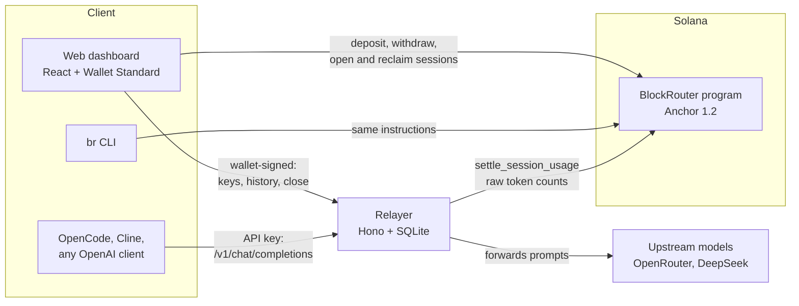
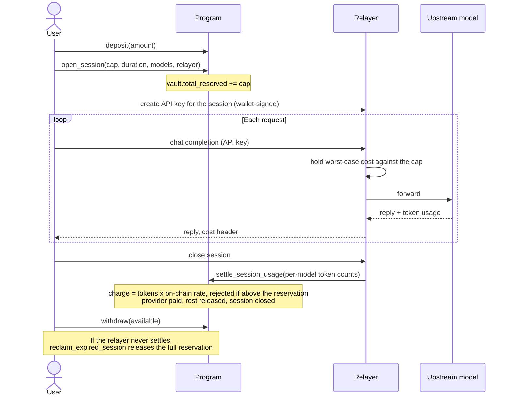
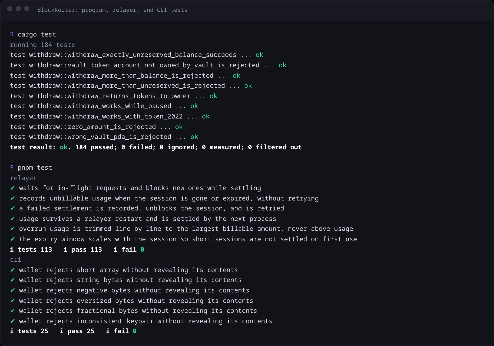

# BlockRouter

Self-custodial stablecoin payments for AI inference on Solana.

AI providers sell non-refundable credits behind an international card. BlockRouter keeps your USDC or
USDT in a vault PDA only you can withdraw from. You lock a capped budget into a session, point any
OpenAI-compatible tool (OpenCode, Cline, the OpenAI SDKs) at the relayer, and the program bills
exact token usage at on-chain rates. Whatever a session does not spend goes back to your vault.

## Devnet deployment

| | |
|---|---|
| Program ID | [`7maTNWbtCpuCXeRUVCNDR2a9YU7kaeUqtvrqz4ustyyi`](https://explorer.solana.com/address/7maTNWbtCpuCXeRUVCNDR2a9YU7kaeUqtvrqz4ustyyi?cluster=devnet) |
| Web app | [blockrouter.netlify.app](https://blockrouter.netlify.app) |
| Relayer | `https://blockrouter.onrender.com` (signer `k3WgqDZLVkKFdmUpFEJ16wketGbzDa6CYU1v1sdmow5`) |
| USDC (Circle devnet) | `4zMMC9srt5Ri5X14GAgXhaHii3GnPAEERYPJgZJDncDU` |
| Mock USDT | `FuLjr7GLgaa6Ciz24YPE1BQdJbmJXRp3AihgPSyEwmb7` |
| Models | `deepseek-v3` ($0.27 / $1.10 per M tokens), `llama-3.3-70b` ($0.59 / $0.79) |

## Architecture



- **Program** (`programs/blockrouter`) holds all funds and enforces every money rule: vault balances,
  session caps, model prices, who may settle, and where payouts go.
- **Relayer** (`relayer`) is an OpenAI-compatible gateway. It checks each API key against an open
  session, holds the worst-case cost of each request in flight so concurrent requests cannot
  overspend, forwards to the upstream model, records token usage, and settles on-chain.
- **Web** (`web`) and **CLI** (`cli`) sign every transaction with the user's wallet. They share a
  `@solana/kit` client generated from the IDL with Codama (`client`).

### Session lifecycle



### Accounts

| Account | Seeds | Holds |
|---|---|---|
| `Config` | `["config"]` | authority, provider (payout wallet), treasury, fee bps, price timelock, pause flag |
| `Model` | `["model", model_id u16 LE]` | prompt and completion rate, pending rate and when it takes effect, active flag |
| `Vault` | `["vault", owner, mint]` | balance, total reserved by open sessions, monotonic session counter |
| `Session` | `["session", vault, session_id u64 LE]` | payer vault, beneficiary, relayer, reserved amount, expiry, up to 8 allowed model ids |

Tokens sit in the vault PDA's associated token account. Both SPL Token and Token-2022 mints work.

### Instructions

| Instruction | Signer | Effect |
|---|---|---|
| `initialize_config` | upgrade authority | one-time setup of authority, provider, fee, and timelock |
| `register_model` | config authority | adds a model and its rates |
| `update_model_price` | config authority | decreases apply now; increases wait out the timelock |
| `initialize_vault` | user | creates the vault for one mint |
| `deposit` | user | moves tokens into the vault |
| `withdraw` | user | moves out at most `balance - total_reserved` |
| `open_session` | user | reserves a cap for one relayer, a set of models, and a duration of 60 s to 7 days |
| `settle_session_usage` | the session's relayer | prices raw token counts per model, pays the provider, releases the rest, closes the session |
| `reclaim_expired_session` | user | after expiry, releases an unsettled reservation and closes the session |

Every instruction that changes state emits an event.

### Invariants

1. `vault.balance >= vault.total_reserved` after every instruction; withdraw can only move the difference.
2. The charge is computed on-chain from raw token counts. The relayer never submits an amount.
3. `charge <= session.reserved_amount`, checked before any transfer.
4. Payouts go only to the provider's token account recorded in `Config`.
5. Only `session.relayer` can settle a session, and settling closes it, so it cannot be billed twice.
6. Session ids come from a monotonic counter, so a session PDA is never reused.
7. All balance math is checked; prices are computed in `u128`.

Pricing, in base units per 1,000,000 tokens, rounded down:

```
charge = (prompt_tokens * prompt_rate + completion_tokens * completion_rate) / 1_000_000
```

### Trust boundary

The program enforces the most a session can spend, the rate per token, which models can be billed,
which relayer may settle, where the payout goes, and that unspent funds return to the user. The
relayer is trusted for the token counts it reports and for which model actually served a request;
neither is verified on-chain. A dishonest relayer can overstate usage only up to the session's cap.

Not built yet: the protocol fee (stored in `Config`, not deducted, so the provider receives the full
charge), sponsor vaults with delegated allowances, settlement escrow with disputes, and an
instruction to toggle the pause flag.

## Repository

| Path | |
|---|---|
| `programs/blockrouter` | Anchor program: `state/`, one handler per file in `instructions/` |
| `tests` | LiteSVM integration tests for the program |
| `client` | Codama-generated `@solana/kit` client plus model-account and auth helpers |
| `relayer` | OpenAI-compatible gateway and settlement worker ([API](relayer/README.md)) |
| `cli` | `br`, the command-line wallet ([commands](cli/README.md)) |
| `web` | dashboard: vault, sessions, API keys with client setup, live activity, playground |
| `scripts` | devnet deploy and seed |
| `deployments` | per-cluster program id, mints, models, and relayer |

## Tests



```sh
anchor build --arch v2 && cargo test   # program: 184 LiteSVM tests
pnpm typecheck && pnpm test            # relayer: 113 tests, CLI: 25 tests
```

CI runs both on every pull request.

## Run locally

Requires Anchor 1.2.0, Solana CLI 3.1.x, Rust 1.98.1, Node.js 22+, and pnpm 11.

```sh
pnpm install --frozen-lockfile
anchor build --arch v2
solana-test-validator --reset --upgradeable-program \
  7maTNWbtCpuCXeRUVCNDR2a9YU7kaeUqtvrqz4ustyyi target/deploy/blockrouter.so keys/devnet-deployer.json
DEPLOYMENT=deployments/localnet.json RPC_URL=http://127.0.0.1:8899 pnpm seed:devnet
cd relayer && CLUSTER=localnet RELAYER_KEYPAIR=../keys/relayer.json node --import tsx src/server.ts
pnpm -C web dev                        # http://127.0.0.1:5173
```

Keypairs live in `keys/`, which is git-ignored. Devnet builds use `--arch v2` because devnet does not
support SBPF v3.
